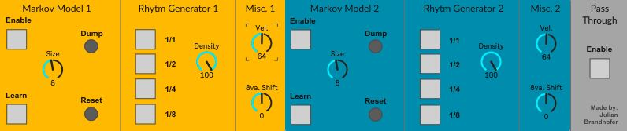
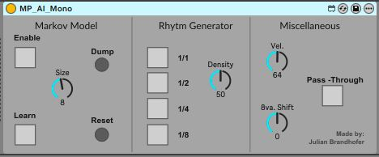

# M-AI – Markov AI for Max for Live

**A real-time improvisation partner for Ableton Live, based on a first-order Markov chain.**

*🇩🇪 [Deutsche Version](README.de.md)*

M-AI is a Max for Live MIDI effect that transforms the input of a performer into musical Output based on MIDI-Data. It learns which notes tend to follow which, and improvises melodic phrases in response – synchronized to Ableton's tempo. It needs no prior training, no dataset and no stylistic preparation: all of its musical material comes directly from the performer's live input.

The device was developed for the piece **_A Duet of Intelligences_** – a composition for pianist, composers and an AI instrument playing a Disklavier. The paper was presented at **AIMC 2026** (see [Background & Paper](#background--paper)).

---

## Contents

| File | Description |
|---|---|
| [`M-AI/MP_M-AI.amxd`](M-AI/MP_M-AI.amxd) | **Dual version** – two independent Markov models, each with its own rhythm generator and settings (the version used in the performance). |
| [`M-AI/MP_AI_Mono.amxd`](M-AI/MP_AI_Mono.amxd) | **Mono version** – a single Markov model. |
| [`M-AI/Piano Example/`](M-AI/Piano%20Example) | Example Ableton Live set (Live 12) with the dual device and a piano instrument. |
| [`M-AI/README.txt`](M-AI/README.txt) | Original short manual. |
| [`docs/paper/`](docs/paper) | Paper *A Duet of Intelligences: Human–AI Co-Creation in Live Piano Performance*. |

---

## Requirements

- **Ableton Live** with **Max for Live** (Live Suite, or Standard + Max for Live). The example set was saved with Live 12; the devices were built with Max 9.
- The external **`ml.markov`** from the *ml.\** machine learning toolkit for Max by Benjamin D. Smith & Guy E. Garnett ("Unsupervised Play: Machine Learning Toolkit for Max", 2012). It is **not** included in the device and must be installed separately:
  1. Open Max (e.g. via *Edit* on the device in Live).
  2. Go to *File → Show Package Manager*, search for **ml.star** and install it.
  3. Restart Live.

> If the device shows a red/dashed `ml.markov` box or produces no notes, the external is missing.

---

## Installation & Quick Start

1. Download this repository (green **Code** button → **Download ZIP**) and unzip it.
2. Install `ml.markov` (see above).
3. Either open `M-AI/Piano Example/Piano Example.als`, **or** set it up yourself:
   - Drag `MP_M-AI.amxd` or `MP_AI_Mono.amxd` onto a **MIDI track** as the **first device**.
   - Add a MIDI instrument after it (Sampler, synth, piano …).
   - Arm the track / set monitoring to *In* so your MIDI keyboard reaches the device.
4. Apply the recommended settings (below) and **start playback or recording** in Live – the rhythm generator runs on Live's transport.
5. Play. After **8 notes** (*Size*) the device builds a model and starts generating phrases from the pitches you played.

All parameters can be changed while playing, and tempo changes are followed automatically.

---

## Parameters

### Markov Model

| Control | Function | Recommended |
|---|---|---|
| **Enable** | Turns output of Markov-generated notes on/off | On |
| **Learn** | Turns periodic re-learning of the model on/off | On |
| **Size** | After how many input notes a new model is computed | 8 |
| **Dump** | Clears all notes from the buffer | – |
| **Reset** | Resets the Markov model | – |

### Rhythm Generator

| Control | Function | Recommended |
|---|---|---|
| **1/1** | Generate whole notes | Off |
| **1/2** | Generate half notes | Off |
| **1/4** | Generate quarter notes | On |
| **1/8** | Generate eighth notes | On |
| **Density** | Percentage of steps that are notes rather than rests | 75 |

When several note values are active, one of them is chosen at random for each step.

### Miscellaneous

| Control | Function | Recommended |
|---|---|---|
| **Vel.** | Velocity of generated notes | 100 |
| **8va. Shift** | Transposes output by *n* octaves up/down | 0 |
| **Pass-Through** | Passes the incoming MIDI through to the instrument | On |

In the dual version, *Markov Model*, *Rhythm Generator* and *Misc.* exist twice (1 = yellow, 2 = blue), so two AI voices with different behaviour can run on the same input.

---

## How it works

- Every incoming note is a **state**. From the buffered notes the model counts how often each note follows another. Example: for **E G E B E G** with current note **E**, the next note is **G** with 67 % and **B** with 33 % probability.
- A **rhythm generator** based on Max's `transport` object decides *when* a note is played (random choice among the enabled note values, rests according to *Density*). This keeps the output locked to Live's tempo.
- The generated pitch sequence is turned into MIDI notes with the selected velocity and octave shift.

---

## Background & Paper

M-AI was created for **_A Duet of Intelligences_**, a piece for a human pianist and a Disklavier (self-playing piano) controlled by this AI. During the final, graphically notated section the pianist improvises with the AI while two composers control the device parameters live – tempo, rhythm, velocity and octave – shifting the balance between alignment and friction.

> Veronika Reutz Drobnić & Julian Brandhofer (2026). *A Duet of Intelligences: Human–AI Co-Creation in Live Piano Performance.* Proceedings of the 7th Conference on AI Music Creativity (AIMC 2026), Berlin, Germany.

- Paper (PDF): [`docs/paper/A-Duet-of-Intelligences_AIMC2026.pdf`](docs/paper/A-Duet-of-Intelligences_AIMC2026.pdf)
- Composer: Veronika Reutz Drobnić – <https://veronikareutz.com/>

If you use M-AI in your work, please cite the paper (GitHub's **"Cite this repository"** button uses [`CITATION.cff`](CITATION.cff)).

---

## Credits

- **Device & implementation:** Julian Brandhofer
- **Composition & concept _A Duet of Intelligences_:** Veronika Reutz Drobnić & Julian Brandhofer
- Institute of Music Informatics and Musicology, University of Music Karlsruhe
- `ml.markov`: B. D. Smith & G. E. Garnett, *Unsupervised Play: Machine Learning Toolkit for Max* (2012)

## License

The Max for Live devices, example set and documentation are licensed under [CC BY-NC 4.0](LICENSE): free to use, share and modify for **non-commercial** purposes with attribution. Music you make with the devices is yours. For commercial use of the devices themselves, please get in touch.

The paper in `docs/paper/` remains under the copyright of its authors and the AIMC proceedings. `ml.markov` is licensed separately by its authors.
